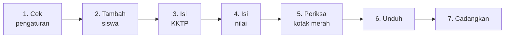

<div align="center">

# 📝 Aplikasi Daftar Nilai UTS

**Isi nilai sekali, unduh sebagai Excel, Word, atau PDF.**
Bentuk lembarnya sama seperti buku nilai sekolah. Tidak perlu paham komputer.

[](https://rehzaherza.github.io/Aplikasi-Daftar-Nilai-UTS/)
[](https://rehzaherza.github.io/Aplikasi-Daftar-Nilai-UTS/panduan-aplikasi-daftar-nilai-uts.html)


</div>

---

## 🧭 Daftar Isi

[Alur singkat](#-alur-singkat) · [Sebelum mulai](#-sebelum-mulai) · [Kenali tampilan](#-kenali-tampilannya) · [Pengaturan](#-atur-lembar-cukup-sekali) · [Siswa](#-masukkan-data-siswa) · [KKTP](#-isi-kktp) · [Nilai](#-isi-nilai) · [Unduh](#-unduh-hasilnya) · [Cadangan](#-cadangkan-datanya) · [Bantuan](#-masalah-yang-sering-terjadi)

---

## ⚡ Alur singkat



---

## 🚪 Sebelum mulai

| | |
|---|---|
| 💻 **Perangkat** | Laptop/komputer paling nyaman. HP juga bisa |
| 🌐 **Peramban** | **Google Chrome** atau **Microsoft Edge** |
| 🔗 **Alamat web** | https://rehzaherza.github.io/Aplikasi-Daftar-Nilai-UTS/ |

> [!IMPORTANT]
> **Data tersimpan di perangkat yang sedang dipakai, bukan di internet.**
> Pakai laptop/HP dan peramban yang sama sampai selesai, jangan menghapus "data penjelajahan" Chrome, dan buat [cadangan](#-cadangkan-datanya) secara berkala.

---

## 🖥️ Kenali tampilannya

Layar terbagi dua: **menu di kiri**, **lembar nilai di kanan**. Di atas lembar ada tiga tab:

| Tab | Gunanya |
|---|---|
| 🧾 **Lembar Siswa** | Mengisi nilai *satu siswa sekaligus* (semua mapel) |
| 📚 **Input per Mapel** | Mengisi nilai *satu mapel sekaligus* untuk semua siswa |
| 📊 **Rekap Kelas** | Satu tabel berisi semua siswa dalam satu kelas |

Arti warna kotak di lembar:

| Warna | Artinya |
|---|---|
| 🟨 Kotak kuning | Boleh diisi: nama, kelas, nilai |
| 🟦 Bingkai biru | KKTP, diisi sekali per mapel |
| ✅ Kolom **Ket** | Terisi sendiri, tidak perlu diketik |

---

## ⚙️ Atur lembar (cukup sekali)

Klik **Pengaturan lembar** di menu kiri, lalu cek isian ini. Semuanya tampil di bagian atas dan tanda tangan lembar nilai.

`Semester` · `Tahun pelajaran (TP)` · `Tempat & tanggal` · `Nama sekolah` · `Kepala sekolah + NIP` · `Wali kelas + NIP`

---

## 👥 Masukkan data siswa

Saat pertama dibuka, aplikasi **belum berisi siswa sama sekali**. Layar menampilkan pilihan untuk menambah siswa, menempel banyak nama, mengimpor Excel/CSV, atau memulihkan cadangan.

> [!TIP]
> **Lakukan ini dulu:** pilih **Kelas X** atau **Kelas XI** di menu kiri, lalu ketik nama kelasnya, misalnya `X RPL`. Semua siswa yang ditambahkan akan memakai kelas itu.
>
> Lembar yang masih kosong **ikut berubah otomatis** saat Anda mengganti tingkat atau mengetik nama kelas di menu kiri. Mengganti **X** menjadi **XI** juga mengubah awalan nama kelas (`X RPL` menjadi `XI RPL`). Untuk lembar yang sudah berisi, aplikasi menampilkan tombol **Ubah jadi …** supaya data lama tidak berubah tanpa sengaja.

Pilih salah satu cara:

| Cara | Langkah |
|---|---|
| **A. Satu per satu** | Klik **+ Tambah siswa**, lalu ketik nama dan kelas di lembar |
| **B. Tempel banyak nama** ⭐ *paling cepat* | Salin daftar nama dari Excel/Word (satu nama per baris) → buka **Tempel banyak nama** → tekan `Ctrl` + `V` → klik **Tambahkan semua** |
| **C. Impor Excel / CSV** | Buka **Impor dari Excel / CSV** → **Pilih berkas** → cek pratinjau → klik **Tambahkan** |

> [!NOTE]
> **Tips file impor:** beri judul **Nama** pada kolom nama (kolom **Kelas** boleh ada). Nama yang sudah ada tidak masuk dua kali. File `.xls` lama: simpan ulang sebagai `.xlsx`.

### 🗑️ Salah masuk? Hapus dengan ✕

- Siswa **kosong** langsung terhapus.
- Siswa yang **sudah ada nilainya**: klik ✕, tombol berubah jadi **Hapus?**, klik sekali lagi.
- **Hapus semua siswa yang kosong** membersihkan baris kosong sekaligus.
- **Hapus semua siswa** mengosongkan seluruh daftar untuk memulai dari awal. Klik sekali, lalu klik lagi saat tombol berubah menjadi peringatan merah. **Buat cadangan dulu** kalau data masih dibutuhkan.

---

## 🎯 Isi KKTP

KKTP adalah batas nilai tuntas. **Tiap mapel punya KKTP sendiri.** Cukup diisi **sekali**, lalu berlaku untuk semua siswa di tingkat yang sama (Kelas X atau Kelas XI).

- Isi di kolom **KKTP** pada lembar, atau di tab **Input per Mapel**.
- Panel **Atur KKTP semua mapel** di tab itu mengisi semua mapel sekaligus.

Kolom **Ket** lalu terisi sendiri:

| Kondisi | Keterangan |
|---|---|
| Nilai ≥ KKTP | ✅ **TUNTAS** |
| Nilai < KKTP | ❌ **TIDAK TUNTAS** |
| KKTP atau nilai masih kosong | (dibiarkan kosong) |

---

## ✍️ Isi nilai

Ada dua cara. Keduanya memakai data yang sama, jadi boleh dipakai bergantian.

### Cara 1: per siswa (tab **Lembar Siswa**)

1. Klik nama siswa di daftar kiri.
2. Klik kotak **NILAI UTS** pertama, ketik nilai, tekan `Enter`.
3. Kursor pindah ke mapel berikutnya. Setelah mapel terakhir, `Enter` melanjutkan ke **siswa berikutnya**. Siswa baru hanya dibuat kalau Anda sudah berada di siswa paling akhir.

### Cara 2: per mata pelajaran (tab **Input per Mapel**)

Cocok untuk guru yang memegang satu mapel dan punya nilai satu kelas.

1. Pilih tingkat dan kelas.
2. Pilih mapel (atau tombol **‹ Mapel** dan **Mapel ›**).
3. Isi **KKTP mapel itu**.
4. Ketik nilai dari atas ke bawah. `Enter` pindah ke siswa berikutnya.

> [!WARNING]
> **Ada kotak berwarna merah?** Artinya isian itu **bukan angka** atau **di luar 0 sampai 100**. Perbaiki sebelum mengunduh.

---

## 📥 Unduh hasilnya

Di menu kiri bagian **Unduh**, pilih cakupan, lalu klik tombol **Excel**, **Word**, atau **PDF**. File tersimpan di folder **Downloads**.

| Pilihan | Hasilnya | Cocok untuk |
|---|---|---|
| **Semua siswa** | 1 file berisi semua siswa (Excel: 1 sheet per siswa; Word/PDF: 1 halaman per siswa) | Mencetak sekaligus |
| **Siswa terpilih saja** | Hanya siswa yang sedang dibuka | Satu siswa |
| **Satu file per siswa (ZIP)** | 1 file ZIP berisi file terpisah tiap siswa | Dikirim ke siswa / orang tua |

Contoh isi file ZIP:

```text
📦 DAFTAR NILAI UTS X RPL per siswa (PDF).zip
 ├─ DAFTAR NILAI UTS - AHMAD FAUZI.pdf
 ├─ DAFTAR NILAI UTS - BUDI SANTOSO.pdf
 └─ DAFTAR NILAI UTS - CITRA DEWI.pdf
```

Membuka ZIP: klik kanan file → **Extract All**. Nama kembar diberi nomor, misalnya `AHMAD (2)`.

### 📊 Rekap satu kelas

Buka tab **Rekap Kelas**, pilih tingkat dan kelas, lalu unduh Excel/Word/PDF. Hasilnya satu tabel berisi semua siswa dan semua mapel, lengkap dengan jumlah, rata-rata, dan keterangan. Nilai di bawah KKTP berwarna merah. Cetaknya mendatar (landscape).

> [!NOTE]
> Siswa yang belum diisi sama sekali **tidak ikut** diunduh, jadi aman kalau masih ada baris kosong.

---

## 💾 Cadangkan datanya

| Tombol | Fungsinya |
|---|---|
| **Cadangkan** | Menyimpan semua data ke satu file `.json`. Simpan di flashdisk atau Google Drive |
| **Pulihkan** | Memasukkan data dari file cadangan (misalnya saat ganti laptop). Pilih file, lalu klik **Ganti data** untuk memastikan |

> [!CAUTION]
> Biasakan membuat cadangan setelah selesai mengisi banyak nilai. Data yang hilang tanpa cadangan **tidak bisa dikembalikan**.

---

## 🆘 Masalah yang sering terjadi

<details>
<summary><b>Data saya hilang</b></summary>

Biasanya karena data penjelajahan Chrome dihapus, atau aplikasi dibuka di laptop/peramban lain. Pulihkan dari file cadangan. Tanpa cadangan, data tidak bisa dikembalikan.
</details>

<details>
<summary><b>Tombol Excel / Word / PDF tidak mengunduh</b></summary>

Pastikan memakai Chrome atau Edge terbaru dan unduhan tidak diblokir. Baca tulisan status kecil di bawah tombol Unduh, biasanya berisi penjelasan.
</details>

<details>
<summary><b>Tab "Input per Mapel" tidak ada</b></summary>

Aplikasi yang terbuka masih versi lama. Hubungi pengelola web untuk memperbaruinya.
</details>

<details>
<summary><b>Kolom Ket kosong</b></summary>

Isi dulu **KKTP** dan **nilai** untuk mapel itu. Keduanya harus terisi.
</details>

<details>
<summary><b>Ada dua siswa dengan nama sama</b></summary>

Boleh. Pada file ZIP, nama file otomatis diberi nomor.
</details>

<details>
<summary><b>Salah memilih Kelas X / Kelas XI</b></summary>

Di atas lembar ada pilihan **Template**. Ganti ke tingkat yang benar, daftar mata pelajaran akan menyesuaikan.
</details>

---

<div align="center">

**Selamat menggunakan!** 🎓

</div>
